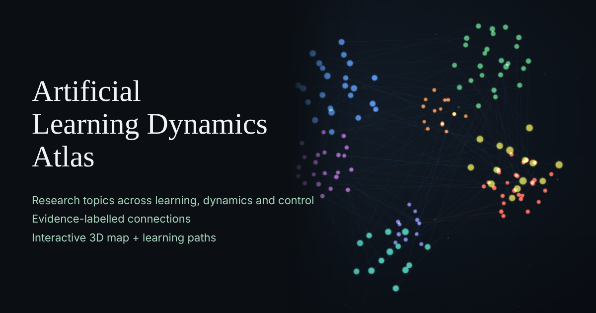

# The Computational Learning Dynamics Atlas

An interactive 3D map of research topics in learning, signals, physics, control and capable AI systems, where every connection carries an evidence label.

**[Open the atlas →](https://apumutyala.github.io/computational-learning-dynamics-atlas/)**



## What it is

The atlas has 161 topics in 8 clusters, joined by 323 recorded connections. The clusters are statistical learning; signals and estimation; neural architectures; physical and generative models; actions and control; theory and learning dynamics; construction and assurance; and capable and grounded systems. Each topic window gives a short description, a primary source and notes on what the topic does and does not establish. Each connection is labelled with one of four evidence levels:

| Label | Count | Meaning |
|---|---|---|
| Exact, conditional | 28 | A mathematical identity that holds under stated assumptions (e.g. ridge regression and the Gaussian-process posterior mean under matched noise and prior). |
| Established | 194 | A well-supported result in the published literature. |
| Empirical | 41 | Observed in experiments, without a general guarantee. |
| Hypothesis | 60 | An untested proposal. Hidden by default. |

Positions group topics by cluster to make them easier to find. **Distance is not evidence.** Two points sitting close together are not thereby related. Only a drawn, labelled connection records a relationship.

## Personalized learning paths

**Personalize my path** (on the welcome card) runs a short onboarding:

1. **Background:** six self-report questions on your maths, probability, ML, control and programming experience, and what you want from the atlas first.
2. **Quick check:** an adaptive set of about 8–12 multiple-choice questions. It picks each question from what it has learned about you so far and stops early once it is confident. "I don't know" is always an option.
3. **Results:** estimated mastery per skill, plus recommended paths with a suggested starting step.

There are 14 curated paths, such as *From regression to Gaussian processes*. A path opens as a step-by-step view on the 3D map. Each step has an objective, a reason it follows the previous step, the connection that links them, a short checkpoint quiz and a "Mark done" toggle. **Paths** in the top bar lists every path whether or not you took the assessment.

Everything runs in your browser. There is no account and no server, and nothing is sent anywhere. Progress is stored in `localStorage` (key `atlas.learn.v1`). **Reset progress** clears it.

## How to use it

| | Desktop | Phone |
|---|---|---|
| Move around | Drag to orbit, scroll to zoom, right-drag to pan | One finger to orbit, pinch to zoom, two fingers to pan |
| Open a topic | Click a point | Tap a point. The topic opens as a bottom sheet; swipe its header down to close it |
| Cross a connection | With a topic open, click a point connected to it | Same, with a tap |
| Find a topic | Type in **Find a topic or researcher** (press `/` to focus it) | Same search box |

- **Crossing a connection** shows the recorded link between the two topics: its evidence label, relation and source. If you pick a topic with no direct link, the atlas shows the shortest route through recorded connections instead.
- The **cluster buttons** along the bottom fly to a cluster and open a summary card for it. The trail above them records the topics you have visited.
- The **view options** menu (≡) has three controls. **Hypotheses** shows or hides the untested connections. **Drift** turns slow auto-rotation on or off. **Overview** returns to the full view.
- `Esc` steps back: it leaves a crossing or route, then closes the topic window.

## Run locally

The site is static and has no build step. It needs a local web server because it loads `atlas.json` with `fetch` and runs as ES modules. Browsers block both on `file://` pages, so opening `index.html` directly shows only the loading screen.

```sh
git clone https://github.com/apumutyala/computational-learning-dynamics-atlas.git
cd computational-learning-dynamics-atlas
python -m http.server 8000
# then open http://localhost:8000
```

## Repo layout

| Path | What it is |
|---|---|
| `index.html`, `style.css` | Page shell, welcome card, top bar and styles |
| `app.js` | 3D scene (three.js), topic windows, crossings, routes, search and the optional AI hooks |
| `learn.js` | Onboarding, adaptive probe, path recommendation and path view |
| `atlas.json` | All topics, connections and clusters |
| `learning/` | Learning-layer data: per-topic metadata, paths, onboarding questions and question banks, plus `SCHEMA.md` and sample `fixtures/` |
| `tools/validate_learning.py` | Validator for `learning/` against `atlas.json` (Python 3 standard library only) |
| `backend/` | Optional Cloudflare Worker for AI features. Not deployed |
| `vendor/` | three.js and OrbitControls, with their licence |
| `og.png` | Social preview image |
| `*.md`, `docs/` | The research notes behind the atlas (see below) |

## Data and contributing

**`atlas.json`** has three arrays: `clusters`, `nodes` and `edges`.

- A **cluster** has `name`, `color`, `count` (shown as a tooltip) and a `center` position.
- A **node** (topic) has `id`, `name`, `group` (a cluster name), `kind` (`topic`, `project` or `proposal`), `authors`, `year`, `text`, `url`, `sourceLabel`, `guide`, the three topic-window notes `handle`, `boundary` and `test` (which accept inline Markdown links), and `p`, its fixed `[x, y, z]` position. Positions are stored, not computed, so place a new node near its cluster's `center`.
- An **edge** (connection) has `id`, `a` and `b` (node ids), `type` (`exact`, `established`, `empirical` or `hypothesis`), `relation`, `text` and a source `url`.

**Learning data** is documented in [`learning/SCHEMA.md`](learning/SCHEMA.md). Before committing, check it with:

```sh
python tools/validate_learning.py
```

It exits non-zero on errors and lists warnings (for example, path steps with no direct edge, or topics on no path).

To **add a topic or connection**:

1. Add the node or edge to `atlas.json`. Edge ids must be unique, and the evidence label should match what the cited source actually shows.
2. For a new topic, add an entry to `learning/nodes.json` with `level`, `skills` and `prereqs`. The validator requires every atlas node to have one.
3. If the totals change, update the counts in `index.html` (the welcome card and `og:description` meta tag) and the cluster's `count`.

To **add a question bank**:

1. Create `learning/questions-N.json` in the `items` format from `SCHEMA.md`. Item ids must be unique across all banks, and items must be plain text with no LaTeX.
2. Add the filename to the `questions` list in `learning/index.json`. The site loads only the banks listed there.
3. Run the validator.

The current banks hold 390 items (178 + 180 + 32).

## Optional AI chat backend

`backend/` holds a small Cloudflare Worker for two optional features: an "Ask the atlas" chat grounded in the topic you are viewing, and AI summaries of why a connection holds. It is **off by default**: `AI_API` in `app.js` is empty, so the site hides all AI UI and makes no AI calls. Turning it on requires your own Anthropic API key, a Cloudflare account and a spending decision. See [`backend/README.md`](backend/README.md) for guardrails, cost estimates and setup.

## The research notes

These are the long-form notes the atlas was built from. Root files:

- [Building Capable Models Intentionally: LLMs, World Models, VLMs, and VLAs](Building%20Capable%20Models%20Intentionally%20%20LLMs%2C%20World%20Models%2C%20VLMs%2C%20and%20VLAs.md): a construction-oriented research programme for designing capabilities on purpose.
- [Controllable and Understandable Learning: Field-by-Field Evidence Map](Controllable%20and%20Understandable%20Learning%20%20Field-by-Field%20Evidence%20Map.md): field by field, how to build models an engineer can understand, change and evaluate.
- [Evidence Ledger: Learning, Dynamics, and Physical Systems](Evidence%20Ledger%20%20Learning%2C%20Dynamics%2C%20and%20Physical%20Systems.md): a retrieval audit of the source URLs behind the notes.
- [Learning Geometry Meets System Control](Learning%20Geometry%20Meets%20System%20Control.md): separates the controlled system, the predictive model and the training process.
- [Mathematical Foundations of Intentional Model Control](Mathematical%20Foundations%20of%20Intentional%20Model%20Control.md): the mathematical bridges for designing useful, correctable learning systems.
- [Unifying Theory — Draft v0](Unifying%20Theory%20%E2%80%94%20Draft%20v0.md) and [Draft v0.1](Unifying%20Theory%20%E2%80%94%20Draft%20v0.1.md): a unifying account from statistical learning to deep, latent and recurrent learning. v0.1 applies the review.
- [Unifying Theory — Open Problems and Tests](Unifying%20Theory%20%E2%80%94%20Open%20Problems%20and%20Tests.md) and [v0.1](Unifying%20Theory%20%E2%80%94%20Open%20Problems%20and%20Tests%20v0.1.md): the claim ledger, conjectures and falsification tests that go with each draft.
- [Unifying Theory — Review v0](Unifying%20Theory%20%E2%80%94%20Review%20v0.md): an independent adversarial review of Draft v0.

In `docs/`:

- [`alignment-synthesis-thesis.pplx.md`](docs/alignment-synthesis-thesis.pplx.md): a research thesis on capable, correctable belief-state systems.
- [`evidence-ledger.pplx.md`](docs/evidence-ledger.pplx.md): an expanded evidence ledger with a capability-learning supplement.
- [`learning-geometry-control-bridges.pplx.md`](docs/learning-geometry-control-bridges.pplx.md): Learning Geometry Meets System Control, as published with the atlas.
- [`signals-statistics-forecasting.pplx.md`](docs/signals-statistics-forecasting.pplx.md): signals, statistics, inference and world-model forecasting.
- [`structure-informed-capability-learning.pplx.md`](docs/structure-informed-capability-learning.pplx.md): constructive training interventions and their measured effects.

These are working research notes. They are a synthesis with cited sources, not peer-reviewed results.

## Credits and licences

- 3D rendering uses [three.js](https://threejs.org/) and its OrbitControls, vendored in `vendor/` under the MIT licence ([`vendor/LICENSE-three.txt`](vendor/LICENSE-three.txt)).
- No licence has been chosen yet for this project's own code, data and notes.
